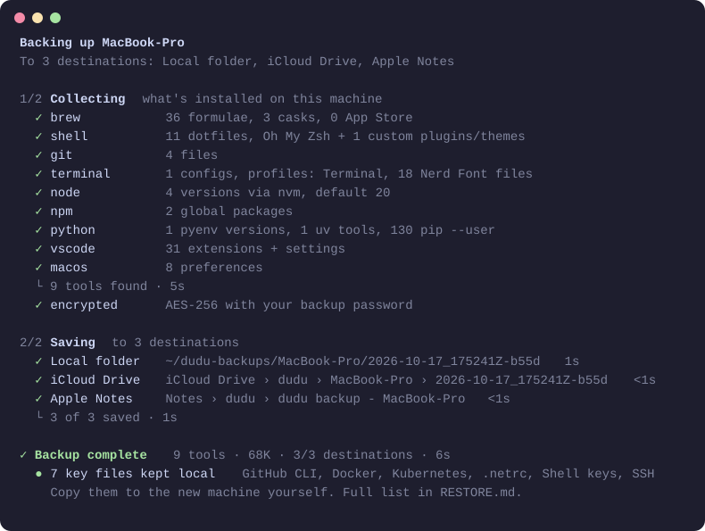

<p align="right"><b>macOS · Linux</b> · <a href="https://github.com/fontnelle/dudu/tree/windows">Windows</a></p>

<div align="center">
  <h1>dudu</h1>
  <p><b>Faça backup de todo o seu ambiente de desenvolvimento com um comando e devolva tudo numa máquina nova com outro. Pacotes, runtimes, dotfiles e terminal, no macOS e no Linux.</b></p>
  <p><a href="README.md">English</a> · Português · <a href="README.es.md">Español</a></p>
  <a href="https://github.com/fontnelle/dudu/stargazers"></a>
  <a href="https://github.com/fontnelle/dudu/releases"></a>
  <a href="LICENSE"></a>
  <a href="https://github.com/fontnelle/dudu/actions/workflows/ci.yml"></a>
  <a href="#começando"></a>
</div>

<p align="center">
  
</p>

## Recursos

- **Tudo que você instalou pelo terminal**: Homebrew, apt/dnf/pacman, versões do Node, pacotes globais do npm/pnpm/yarn/bun, pyenv/pipx/uv, gems, cargo, ferramentas do go, extensões do VS Code e do Cursor
- **Seu terminal, do jeito que estava**: zsh, Oh My Zsh e plugins, Powerlevel10k/Starship, perfis do Terminal.app e do iTerm2, Ghostty, Kitty, WezTerm, Nerd Fonts, config do git e do SSH
- **Salvo onde você já está**: pasta local, iCloud Drive, Google Drive e Apple Notes, vários ao mesmo tempo
- **Segredos ficam em casa**: tokens nos dotfiles são mascarados, arquivos de chave nunca são copiados, e o `dudu secrets` tira as chaves do seu `.zshrc`
- **Criptografado, se você quiser**: AES-256 com uma senha guardada no seu Keychain
- **Restore seguro**: o backup é tratado como não confiável, conferido pelos checksums, e nenhum arquivo é sobrescrito sem ficar uma cópia
- **Roda sozinho**: um backup por dia com `dudu schedule on`
- **Fala a sua língua**: English, Português (Brasil) e Español, pelo idioma do sistema
- **Bash puro, sem dependências**: funciona com o bash 3.2 que vem no macOS

## Começando

**No Windows?** O dudu para Windows fica na [branch `windows`](https://github.com/fontnelle/dudu/tree/windows), com instalador próprio para o PowerShell.

**Instale pelo Homebrew**

```bash
brew install fontnelle/tap/dudu
```

**Ou pelo script**

```bash
curl -fsSL https://raw.githubusercontent.com/fontnelle/dudu/main/install.sh | bash
```

O script confere o release pelo `SHA256SUMS`. Opções: `| bash -s -- 0.1.0` para uma versão, `| bash -s -- --prefix ~/.local/bin` para escolher onde fica o comando.

**Use**

```bash
dudu                 # menu interativo
dudu backup          # salva tudo nos seus destinos
dudu restore         # na máquina nova: reinstala tudo
dudu status          # o que mudou desde o último backup
dudu outdated        # atualizações do brew, npm, pip, gems, Node LTS... e atualiza tudo ou escolhe
dudu secrets         # chaves nos seus arquivos de config, e como movê-las para ~/.secrets
dudu schedule on     # um backup por dia (12:30, ou: dudu schedule on 08:00)
dudu config          # destinos, idioma, criptografia, agendamento
```

Todos os comandos aceitam `--dry-run` e `--only brew,node,...`. O `restore` também aceita `--from <máquina>` (backup de outro computador), `--file <pasta>` (backup copiado à mão) e `--yes`. Com `--debug`, cada passo vai para `~/.cache/dudu/dudu.log` (precisa de bash 4.1+).

## Máquina nova, passo a passo

```bash
brew install fontnelle/tap/dudu   # ou o script, num Mac ainda sem Homebrew
dudu config                       # o mesmo destino da máquina antiga
dudu restore --dry-run            # veja o que vai acontecer
dudu restore
```

O restore roda em ordem: primeiro o Homebrew (que traz pyenv, go, fontes...), depois a config do shell e do git, as versões do Node, os pacotes globais, os editores e as preferências do macOS. Todo passo pode ser repetido: o que já está instalado é pulado, e um arquivo diferente fica guardado como `<arquivo>.dudu-bak`.

## Do Mac para o Linux

Um backup feito no Mac também restaura no Linux, até onde o Linux permite. A ponte é o Google Drive: as duas máquinas acessam ele pelo `rclone`, configurado com `dudu config gdrive`.

```bash
# No Mac: conecte o Google Drive e faça o backup
dudu config gdrive
dudu backup

# No Linux
curl -fsSL https://raw.githubusercontent.com/fontnelle/dudu/main/install.sh | bash
dudu config gdrive              # 1: a mesma conta Google, ele lista o Mac
dudu restore --dry-run --from <nome do mac>
dudu restore --from <nome do mac>
```

- **O Homebrew vira pacotes do sistema.** As fórmulas são instaladas com apt, dnf ou pacman com o mesmo nome, quando o repositório tem o pacote (`fd` vira `fd-find`, `node` vira `nodejs`...). Os casks conhecidos vêm do sistema ou do Flathub (VS Code, Chrome, Slack, Spotify, Obsidian...). O Homebrew em si não é instalado. Se ele já estiver na máquina, as fórmulas sem pacote nativo são instaladas por ele.
- **As configurações vão para os caminhos do Linux.** As do VS Code e do Cursor saem de `~/Library/Application Support` e vão para `~/.config`, e as do Ghostty também.
- **Antes de instalar qualquer coisa, o plano mostra o que fica de fora:** apps da Mac App Store, casks sem versão para Linux, preferências do macOS e perfis do Terminal.app/iTerm2.

Os nomes que mudam estão em [`lib/data/brew-linux.map`](lib/data/brew-linux.map). Para incluir um app que falta, basta uma linha.

## Onde os backups ficam

| Destino | Onde | Observações |
| --- | --- | --- |
| Pasta local | `~/dudu-backups` ou qualquer pasta | Padrão |
| iCloud Drive | `iCloud Drive/dudu` | macOS |
| Google Drive | `Meu Drive/dudu-<máquina>` | `dudu config gdrive`, no macOS e no Linux, em 4 etapas (veja abaixo). O Drive for desktop é usado se estiver instalado. Pasta sincronizada: `dudu config set gdrive_path <pasta>` |
| Apple Notes | a nota `dudu backup - <máquina>` na pasta `dudu` | macOS. Um resumo legível mais o backup inteiro embutido. O primeiro backup pede permissão para controlar o Notes |

**`dudu config gdrive`** salva direto no Google Drive, sem o Drive for desktop:

1. **rclone**: instala, se faltar (`brew install rclone`, ou apt/dnf/pacman).
2. **Pasta**: escolha **1, conectar minha conta Google**, e o dudu cria `dudu-<máquina>` no Meu Drive. Assim ele só enxerga os arquivos que ele mesmo cria (acesso `drive.file`), nada mais do seu Drive. Ou escolha **2, colar o link de uma pasta** que você já tem (no Drive: botão direito › Compartilhar › Copiar link). Um link errado diz o motivo: é um arquivo e não uma pasta, é outro site, é um encurtador. Uma pasta colada precisa de acesso ao Drive inteiro, e cada máquina ganha a sua `dudu-<máquina>` dentro dela.
3. **Conta Google**: um navegador abre para você entrar uma vez. O dudu usa um remote próprio do rclone (`dudu-gdrive`), então os seus outros remotes não são tocados.
4. **Verificações**: um arquivo de teste é gravado, lido de volta e apagado. A config do rclone, onde fica o token do Google, passa a ser legível só por você. Se a criptografia estiver desligada, o dudu oferece ligar. Ele também lista as máquinas que já têm backup lá.

No fim, e depois de cada backup, o dudu mostra o link da pasta para abrir no navegador. Se uma etapa falha, nada é salvo e a configuração anterior continua valendo. Se o Mac salva pelo Drive for desktop: no Linux, escolha 2 e cole o link da pasta `dudu` dele. Como ela não foi criada pelo dudu, não aparece com `drive.file`.

Escolha **um ou mais** com `dudu config` ou `dudu config set destination icloud,notes`. Cada backup vai para todos, e um que falhe não impede os outros. `restore` e `status` usam o backup mais novo entre eles. Nas pastas ficam os 5 últimos backups de cada máquina (`dudu config set keep 10`).

## O que entra no backup

| Collector | Salva | Restaura com |
| --- | --- | --- |
| `brew` | Brewfile (formulae, casks, taps, Mac App Store) | `brew bundle install` (instala o Homebrew se preciso). No Linux, o Brewfile de um Mac vira pacotes apt/dnf/pacman e Flathub |
| `syspkgs` | pacotes apt/dnf/pacman instalados por você, flatpak, snap | o gerenciador de pacotes do sistema |
| `shell` | `.zshrc`, `.zprofile`, `.bashrc`, `.p10k.zsh`, `starship.toml`, tmux, vim, fish, nvim, plugins e temas custom do Oh My Zsh (como URLs git) | copia os arquivos, instala o Oh My Zsh, clona os plugins |
| `git` | `.gitconfig`, gitignore global, `~/.ssh/config`, config do gh | copia os arquivos |
| `terminal` | perfis do Terminal.app e do iTerm2, Ghostty, Alacritty, Kitty, WezTerm, a lista de Nerd Fonts | `defaults import`, copia os arquivos |
| `node` | versões do nvm (ou fnm/volta) e a padrão | instala o nvm, `nvm install` de cada versão |
| `npm` `pnpm` `yarn` `bun` | pacotes globais (por versão do Node, com nvm), `.npmrc` | `npm install -g` ... |
| `python` | versões do pyenv, ferramentas do pipx e do uv, `pip --user` | `pyenv install`, `pipx install`, `uv tool install` |
| `ruby` `cargo` `go` | gems/rbenv, crates do `cargo install`, ferramentas do `go install` | as mesmas ferramentas |
| `vscode` `cursor` | extensões, settings, atalhos, snippets | `code --install-extension` |
| `macos` | uma seleção de preferências do Dock, Finder, teclado e screenshots | `defaults write` |

Pule collectors com `dudu config set exclude macos,ruby`, ou fique só com alguns com `dudu config set include brew,node,shell`.

## Segurança

**Segredos não saem da sua máquina**

- Valores com cara de segredo (`TOKEN=`, `_authToken=`, `password:`, `api_key`, `Bearer …`, `https://user:senha@`, `ghp_…`, `sk-…`, `npm_…`, `AKIA…`, JWTs, blocos de chave privada) viram `<redacted-by-dudu>` no backup. Referências como `$(security …)` ou `$MINHA_VAR` são mantidas.
- Arquivos de chave nunca são copiados: `~/.ssh/id_*`, `~/.gnupg`, `~/.aws/credentials`, `~/.netrc`, `~/.kube/config`, `~/.docker/config.json`, tokens do `gh`, `~/.secrets`. O dudu lista os que encontrou para você levar por conta própria.
- Um arquivo que o dudu não consegue checar fica fora do backup, nunca é copiado como está.
- Todo backup termina listando as chaves que mascarou: arquivo, linha e nome, nunca o valor. O `dudu secrets` oferece mover as linhas `export NOME=…` dos seus arquivos de shell para `~/.secrets` (permissão 600), que o `.zshrc` passa a carregar no mesmo ponto.
- No restore, um arquivo cuja única diferença é o segredo mascarado não é sobrescrito, então restaurar na mesma máquina nunca apaga seus tokens.

**Criptografia**

`dudu config set encrypt on` pede uma senha (12+ caracteres) e a guarda no Keychain do macOS (no Linux, `secret-tool` ou `~/.config/dudu/key` com permissão 600). Cada backup vira um `backup.enc` (AES-256-CBC, PBKDF2 com 200.000 rodadas, via `openssl`) mais um MAC, conferido antes de decifrar qualquer coisa. Só o `manifest.json` (nome da máquina, data, quais ferramentas) e um `RESTORE.md` genérico ficam legíveis. Numa máquina nova, o `dudu restore` pede a senha. **Sem ela o backup não pode ser restaurado**, então guarde-a no seu gerenciador de senhas.

**O que um backup pode e não pode fazer com você**

Quem tiver acesso à conta do iCloud ou do Google Drive pode alterar uma pasta de backup lá, então o dudu a trata como não confiável no restore:

- nomes de pacote são validados (sem opções, URLs ou caminhos) antes de chegar ao `apt`, `brew`, `npm`, `pip`...;
- o Brewfile fica só com linhas `tap`/`brew`/`cask`/`mas`/`vscode`, então não roda Ruby;
- arquivos só voltam para os caminhos que cada ferramenta salva, nunca para `~/.ssh/authorized_keys`, `~/Library/LaunchAgents` ou `~/.secrets`, e nunca através de symlink;
- preferências do macOS se limitam a uma lista conhecida, e todo arquivo sobrescrito fica como `.dudu-bak`.

Com a criptografia ligada, a checagem do MAC vem primeiro: um backup alterado é recusado antes de qualquer coisa rodar.

## Confiabilidade

- Todo backup leva um `SHA256SUMS`. A gravação vai para uma pasta `.partial`, é conferida e só então renomeada, então um save interrompido nunca vira o backup usado no restore. No Notes, a nota é lida de volta e conferida, e a anterior fica como "(previous)".
- `restore` e `status` conferem os checksums e usam o backup anterior se o mais novo estiver danificado.
- Uma ferramenta que falha ou estoura o tempo mantém a cópia do último backup bom, e o backup avisa em vez de dizer "complete".
- `keep` nunca é menor que 1, e a limpeza nunca apaga o backup completo mais novo nem o que acabou de ser salvo.
- Duas máquinas com o mesmo nome salvam em pastas separadas, diferenciadas por um id de hardware com hash.
- Só um dudu roda por vez. Ctrl-C para o passo atual e tudo que ele iniciou, e apaga os temporários.

**Códigos de saída**

| Código | Significado |
| --- | --- |
| 0 | Tudo certo |
| 1 | Erro: nada foi salvo ou restaurado |
| 2 | Parcial: um destino falhou, uma ferramenta não pôde ser lida ou um passo do restore falhou |
| 3 | Só no `status`: a máquina mudou desde o último backup |
| 130 | Interrompido (Ctrl-C) |

## Backup agendado

`dudu schedule on [HH:MM]` cria um backup diário: um LaunchAgent no macOS e um timer de usuário do systemd no Linux. Ele roda sem terminal, então usa a senha do backup que está guardada, e uma falha aparece como notificação. Se você usa o Apple Notes, faça antes um backup à mão para o macOS pedir a permissão. `dudu schedule status` mostra o agendamento e `dudu schedule off` o remove.

## Idioma

O dudu fala English, Português (Brasil) e Español. Ele segue o idioma do sistema (`LANG`, ou Ajustes do Sistema no macOS) sem precisar configurar nada, e o primeiro uso avisa qual idioma escolheu.

```bash
dudu config set language es      # en, pt-BR, es, ou auto para voltar a seguir o sistema
DUDU_LANG=en dudu status         # um comando em outro idioma
```

Ou pelo menu: **Configurações › Idioma**. O `RESTORE.md` de um backup (e a nota dele no Apple Notes) sai no idioma da máquina que fez o backup. As descrições do autocompletar do zsh seguem a mesma configuração.

## Autocompletar e highlighting no terminal

```bash
dudu completion zsh > "${fpath[1]}/_dudu"                       # autocompletar no zsh
echo 'eval "$(dudu completion bash)"' >> ~/.bashrc              # autocompletar no bash
echo "source $(dudu completion highlight --path)" >> ~/.zshrc   # highlighting no zsh
```

O Homebrew já instala o autocompletar. Com [fast-syntax-highlighting](https://github.com/zdharma-continuum/fast-syntax-highlighting) ou [zsh-syntax-highlighting](https://github.com/zsh-users/zsh-syntax-highlighting), `dudu backup` aparece com o subcomando em amarelo enquanto você digita, e um erro como `dudu bakcup` em vermelho.

## Criando um collector

Cada ferramenta é um arquivo em `lib/collectors/<nome>.sh`:

```bash
foo_detect()   { has foo; }                                   # está nesta máquina?
foo_backup()   { foo list > "$1/list.txt" || return 1; summary "$1" "$(tn "%d thing" "%d things" "$n")"; }
foo_restore()  { act foo install ...; }                        # act executa, ou só mostra no --dry-run
foo_outdated() { foo outdated; }                              # opcional: "nome atual mais_nova" por linha
foo_upgrade()  { foo upgrade "$1"; }                          # opcional: atualiza um pacote
```

Depois inclua o nome em `DUDU_COLLECTORS` no `lib/core/common.sh` (a ordem é a ordem do restore). A função de backup retorna erro quando a ferramenta falha, para o dudu manter a última cópia boa. Passe listas de pacotes pelo `missing_pkgs` e arquivos de config pelo `save_file` e pelo `restore_home <pasta> <caminhos permitidos>`: eles validam nomes, mascaram segredos e guardam as cópias `.dudu-bak`.

## Desenvolvimento

```bash
make check     # shellcheck + bats + catálogos de tradução
make install   # liga este checkout como ~/.local/bin/dudu
```

O código precisa rodar no bash 3.2 (o padrão do macOS): sem arrays associativos, sem `mapfile`, sem `${var,,}`, e `${VAR}` antes de qualquer caractere não ASCII. As mensagens são escritas em inglês como `t "texto %s" "$valor"` (ou `tn` para plural) e traduzidas em `lib/i18n/pt-BR.sh` e `lib/i18n/es.sh`; o `make check` falha quando falta uma mensagem num catálogo. O CI roda os testes no macOS, no bash 3.2, no Ubuntu, no Fedora e no Arch.

## Licença

MIT.
